# B58 Apps für den MGU Store

Vier Apps für den **BMW M340i (G20/G21) mit B58-Motor und iDrive 7**, installiert über den
[mgu-store](https://github.com/robertnisipeanu/mgu-store). Sie lesen die Motorsteuerung (DME `0x12`,
SGBD `DME8FF_R`) und die Signale, die das Auto ohnehin an die Headunit schickt. Gedacht für einen Serienmotor.

| App | Was sie zeigt |
|---|---|
| **Motor-Check** | Der Gesundheitsverlauf des Motors über Wochen und Monate. Gemessen wird bei warmem Motor im Leerlauf oder bei gleichmäßiger Fahrt. Erfasst werden Fehlzündungen, Laufruhe und Injektor-Korrektur je Zylinder, Gemischadaption, Ölstand und Ölverbrauch, Kraftstoff im Öl, Öldruck im warmen Leerlauf, Warmlauf, Klopfadaption und die Restlaufzeit der Zündkerzen. Jeder Bereich wird mit „OK“, „beobachten“ oder „prüfen lassen“ bewertet. |
| **Sprit-Check** | Welcher Kraftstoff lohnt sich? Jedes Tanken wird von selbst erkannt. Je Tankfüllung und Sorte zeigt die App Verbrauch, Kosten je 100 km, die vom Motor adaptierte Oktanzahl, die Zündrücknahme der Klopfregelung unter Volllast und die Qualitätseinstufung des Motorsteuergeräts. Dazu kommt der Vergleich der Sorten. |
| **Pull-Check** | Bewertet jede Volllastbeschleunigung von selbst: Ladedruck gegen Sollwert, Zündrücknahme, Raildruck, Erwärmung der Ansaugluft und Lambda. Dazu kommt die Leistung an den Rädern, geschätzt aus Beschleunigung und Tempo. Der Vergleich läuft gegen eine Referenzmessung im selben Gang. |
| **Verbrauchs-Coach** | Der echte Spritverbrauch aus dem Einspritzzähler, verglichen mit dem, was dein Auto bei gleichem Tempo mit warmem Motor sonst braucht. Aufgeschlüsselt nach Tempo, Außentemperatur, Fahrmodus und Klima. Dazu, was Kaltstarts und Kurzstrecken kosten, mit Kosten je Fahrt und der Reichweite bei der aktuellen Fahrweise. |

> **Hinweis:** Inoffizielles Hobbyprojekt, nicht von BMW. Benutzung auf eigenes Risiko; die Apps sind für den
> Blick im Stand oder vom Beifahrer gedacht. Sie **lesen nur** (UDS `0x22 ReadDataByIdentifier`, ersatzweise
> OBD-II Service `01`) und schreiben nichts ins Auto. Eine Bewertung wie „prüfen lassen“ ist eine Faustregel
> der App, keine Diagnose von BMW: Den Fehlerspeicher liest eine Werkstatt oder ein Diagnosegerät.
> **Pull-Check:** Vollgas nur dort, wo es sicher und erlaubt ist.

## Stand: noch nicht im Auto getestet

- **Getestet:**
  - 18 Logiktests in `node test/run.js`, darunter der ganze UDS- und OBD-Weg gegen ein simuliertes Motorsteuergerät;
  - die Bewertungen von Motor-Check, Sprit-Check und Pull-Check sowie die Fahrten- und Kaltstartrechnung des Verbrauchs-Coach;
  - die Vorschau aller Seiten mit Demo-Daten und ohne Daten (`tools/preview.sh`);
  - eine Prüfung auf Syntax, die die Headunit (Node 8.16) nicht kennt (`tools/check_node8.sh`).
- **Nicht getestet:** auf einer echten Headunit oder in einem M340i.
  - Die DIDs der Motorsteuerung (`0x12`) stammen aus dem DME8FF_R-Katalog der App *Live Data* aus
    [idrive7-apps](https://github.com/cauliflowermossgrape/idrive7-apps) (aus der öffentlichen SGBD-Referenz erstellt).
    Ich habe sie nicht selbst am Auto geprüft.
  - Der Faktor des Einspritzzählers wird im Auto gegen den Durchfluss des Motorsteuergeräts gelernt; bis dahin
    liest der Verbrauchs-Coach den Durchfluss direkt.
  - Der Bau mit dem echten BMW-SDK auf der Headunit lief noch nie.

**Darum beim ersten Start im Auto:** In jeder App unter Einstellungen die **Diagnoseseite** einschalten. Sie
zeigt jede Antwort des Motorsteuergeräts mit Rohbytes, Wert oder Fehler. Wenn ein Wert fehlt oder unplausibel ist,
lassen sich DIDs und Skalierung pro App in `apps/<id>/app.json` unter `config.dme` anpassen. Vorlage und alle
Kandidaten stehen in `lib/lib_dme.js` unter `DEFAULTS`.

## Installation über den MGU Store

Voraussetzung: Der MGU Store ist auf der Headunit installiert. Dazu braucht man Root-SSH, siehe die
[README des Stores](https://github.com/robertnisipeanu/mgu-store#requirements).

Die Apps liegen im Branch **`m340i`** von [Freeway6/BMWeDriveApps](https://github.com/Freeway6/BMWeDriveApps).
Der Branch `main` desselben Repositorys enthält die Apps für den i4; jedes Auto bekommt nur seinen Branch als Quelle.

1. Im Auto: Store → Settings → **Add source** → `Freeway6/BMWeDriveApps` eingeben → den Branch **`m340i`** wählen.
   Ist das Repository privat, braucht der Store dafür einen Zugang (Settings → **Accounts**: *Sign in with GitHub*
   oder ein Token mit Leserecht auf *Contents*).
2. Im Store die Apps öffnen und **Install** tippen. Die Headunit baut sie selbst aus dem Quelltext; das BMW-SDK nimmt sie von einer Original-App im Auto.
3. Erscheint eine App danach nicht, die Headunit neu starten: Settings → **Restart head unit**.
4. Neue Commits auf `m340i` erscheinen im Store als Update (Installed → **Update**).

Die Apps starten mit dem Auto (`autostart`) und zeichnen im Hintergrund auf, auch wenn ihr Bildschirm nicht offen
ist. Für eine Grafik mit 60 fps sorgt der Renderer, den der Store mitinstalliert. Ohne ihn zeichnen die Apps
langsamer (PNG, etwa 2 Bilder/s).

## Wie die Apps lesen

- **Motorsteuergerät** (DME `0x12`). Gefragt wird mit UDS `0x22`; antwortet ein DID nicht, mit dem
  passenden OBD-II-PID. Die App merkt sich, welcher Kandidat antwortet. Die wichtigsten DIDs:
  - Öl: Temperatur `4402`, Druck `4436`, Stand über Minimum `5811`/`442F`, Kraftstoff im Öl `593A`, Restlebensdauer `411A`;
  - Zylinder: Fehlzündungen `4B23`–`4B25`, `4B30`–`4B32`; Laufruhe `4A30`–`4A35`; Injektor-Korrektur `55B4`–`55B9`;
  - Gemisch: Lambda `5889`, Soll `5816`, Gemischadaption `4A9D`, Kurz-/Langzeitkorrektur (OBD `06`/`07`);
  - Kraftstoff: Durchfluss `5656`, adaptierte Oktanzahl `5776`, Zeit seit dem Tanken `57E3`, Qualität der letzten Tankfüllungen `4035`;
  - Leistung: Ladedruck `580B`, Soll `4AB0`; Raildruck `58EF`, Soll `5837`; Ansaugluft `580F`;
  - Zündung: Klopfregelung `554C`, Klopfadaption `554A`, Zündkerzen `5489`/`4163`.
- **Fahrzeugsignale** (SOME/IP, ohne Anfrage an ein Steuergerät):
  - Tempo, Außentemperatur, Fahrzeugzustand;
  - Drehzahl, Kühlmittel- und Öltemperatur, Motorstatus;
  - Tankinhalt, Reichweite und Kilometerstand vom Kombi;
  - Einspritzzähler, Längsbeschleunigung, Gaspedal;
  - Fahrmodus (Eco Pro, Comfort, Sport, Adaptiv), Leistungsanzeige, Klima an/aus.
- **Wie oft das Motorsteuergerät gefragt wird:**
  - *Motor-Check:* eine Messung bei warmem Motor, höchstens alle paar Stunden (Einstellung).
  - *Sprit-Check:*
    - unter Volllast etwa einmal pro Sekunde die Klopfregelung;
    - alle 5 Minuten Oktanzahl und Klopfadaption;
    - je Fahrt einmal die Tankqualität;
    - den Durchfluss jeweils eine Minute lang, alle 2 Minuten, bis der Faktor des Einspritzzählers gelernt ist,
      danach alle 30 Minuten;
    - nach einem erkannten Tanken einmal die Zeit seit dem Tanken.
  - *Pull-Check:* nur während eines Pulls, etwa 10 Werte pro Sekunde.
  - *Verbrauchs-Coach:* den Durchfluss einmal pro Sekunde, bis der Faktor des Einspritzzählers gelernt ist; danach
    eine Minute alle 30 Minuten zur Kontrolle.
- **Bus-Ruhe:** Ist das Auto abgeschlossen und verlassen (Fahrzeugzustand ≤ 3), fragt keine App das
  Motorsteuergerät. Bei stehendem Motor auch nicht, mit einer Ausnahme: Sprit-Check fragt nach einem erkannten
  Tanken einmal die Zeit seit dem Tanken.
- **Daten** bleiben im Datenordner der App auf der Headunit; nichts geht ins Internet.

Die Grenzen der Bewertungen sind Faustregeln für einen Serien-B58, nicht BMW-Vorgaben. Wo es geht, vergleichen die
Apps mit den eigenen früheren Werten des Motors: Öldruck bei gleicher Öltemperatur, Warmlauf bei gleicher
Außentemperatur, Pulls im selben Gang. Die Leistung an den Rädern rechnet Pull-Check aus Masse (Einstellung),
Luft- und Rollwiderstand. Sie ist eine Schätzung für den Vergleich mit sich selbst, kein Prüfstandswert.

## Bildschirme (Vorschau mit Demo-Daten)

**Motor-Check**

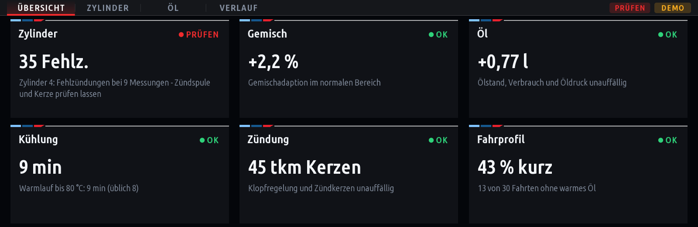
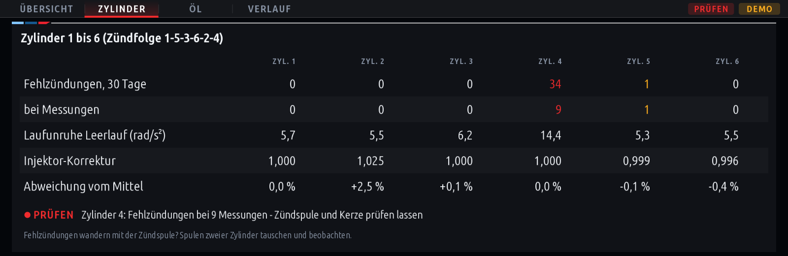
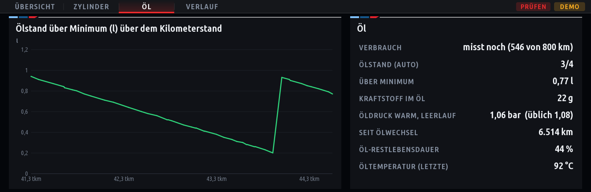
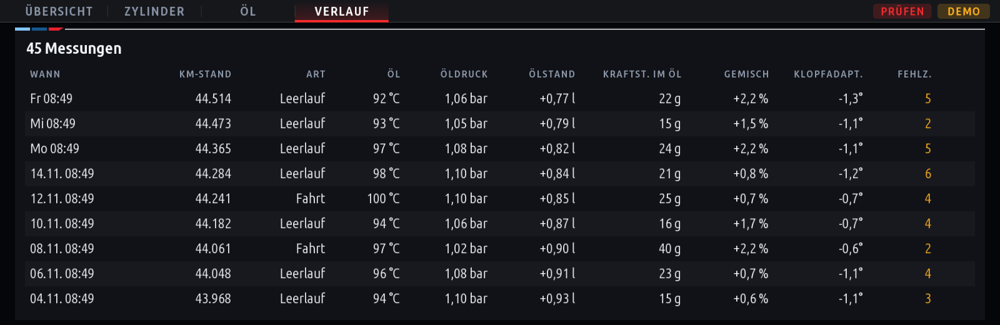

**Sprit-Check**

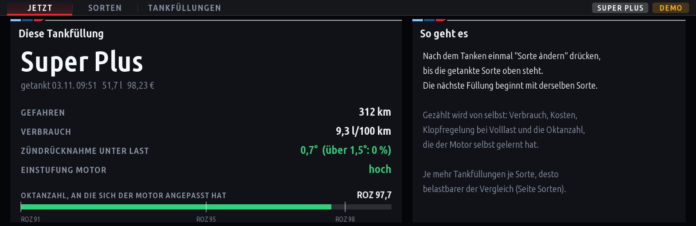
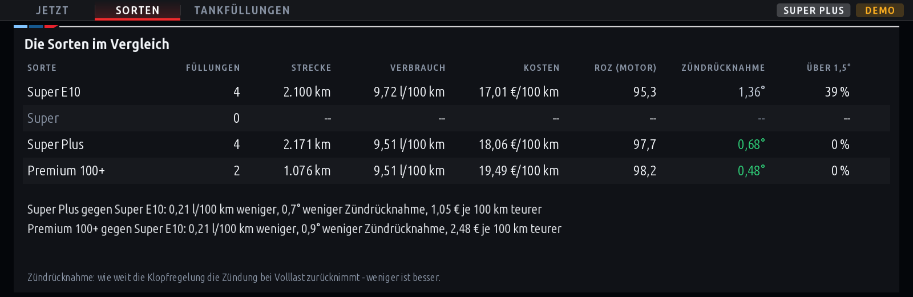
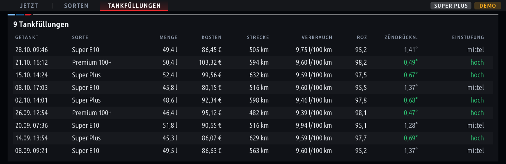

**Pull-Check**

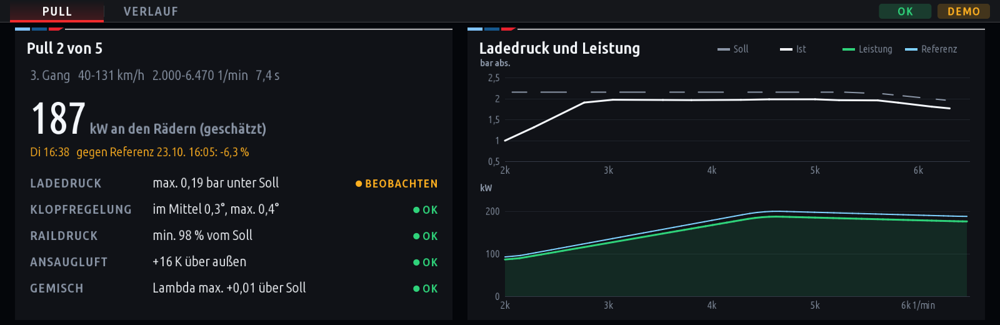
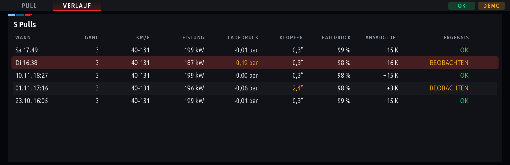

**Verbrauchs-Coach**

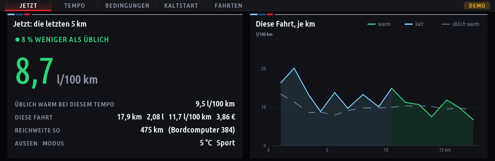


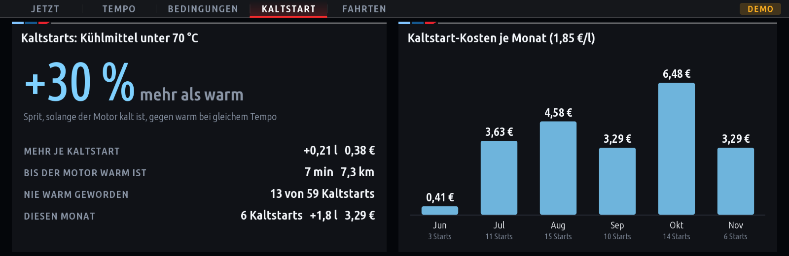
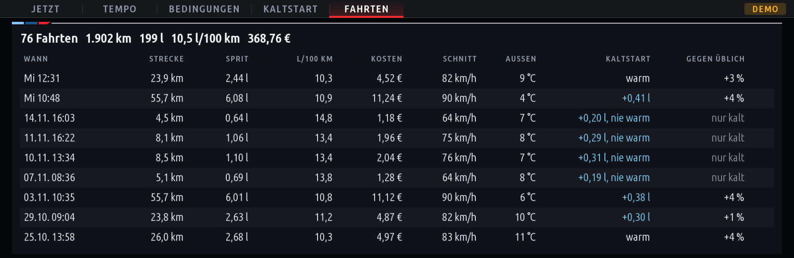

Die Oberfläche ist deutsch: Dezimalkomma, Tausenderpunkt, €, deutsche Wochentage. Die Fahrmodi heißen wie im Auto.
Für die Umlaute bringen die Apps eigene Schriftatlanten mit (`i18n/fonts/de`): die des Kits, um ÄÖÜäöüß ergänzt,
mit `tools/bake_german.py` aus derselben Ubuntu-Schrift erzeugt. Die Texte, die das Kit selbst zeichnet
(„Settings“, „Back“, „On/Off“ …), übersetzt der Katalog `i18n/de.json`.

## Entwicklung

Voraussetzungen: Python 3, Node.js. Ein Auto ist dafür nicht nötig.

```sh
node test/run.js            # Logiktests (lib/ und die Bewertungen der Apps), inkl. UDS-Weg gegen ein simuliertes Steuergerät
tools/preview.sh            # baut alle Apps ohne SDK und speichert jede Seite als PNG in preview/<id>/ und preview/<id>-empty/
tools/check_node8.sh        # Syntax, die Node 8.16 auf der Headunit nicht kennt
node tools/make_icons.js    # die vier Kachel-Icons
```

| Pfad | Inhalt |
|---|---|
| `apps/<id>/` | `app.json` (Signale, Bildschirme, Einstellungen, `config.dme`), `main.js`, die eigene Logik der App (`health.js`, `tank.js`, `pull.js`, `drive.js`), `icon.png` |
| `lib/` | gemeinsamer Code, beim Bau flach in jede App kopiert. Er enthält: Motorsteuergerät lesen (`lib_uds`, `lib_dme`), Fahrzeugsignale, Kraftstofffluss, Fahrten, Verbrauch nach Bedingungen, Fahrphysik, Demo-Daten und Bildschirmbausteine |
| `kit/` | MGU App Kit aus [idrive7-apps](https://github.com/cauliflowermossgrape/idrive7-apps) (MIT), unverändert übernommen; siehe `kit/README.md` |
| `i18n/` | Deutsch: Katalog für die Texte des Kits (`de.json`) und die Schriftatlanten mit Umlauten (`fonts/de/`) |
| `tools/build.py` | baut eine App als deutsches Paket. Zuerst wird `lib/` hineinkopiert, dann läuft der Bau des Kits mit den deutschen Atlanten und dem Katalog. Der Store ruft das auf der Headunit auf (`mgu-repo.json`) |
| `tools/bake_german.py` | erzeugt `i18n/fonts/de` neu (Pillow mit raqm, Ubuntu-Schrift: `apt-get install fonts-ubuntu`) |
| `mgu-repo.json` | Beschreibung für den Store: Apps in `apps/*`, Bau auf der Headunit |

Der Code läuft auf der Headunit mit Node 8.16. Darum gibt es kein `?.`, kein `??`, kein `Array.flat` und kein
rekursives `mkdir`.

## Lizenz

MIT (`LICENSE`). Drittanbieter-Teile: `THIRD_PARTY_NOTICES.md`.
