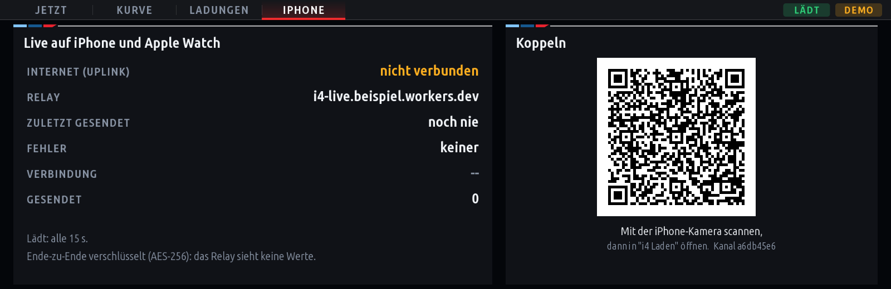
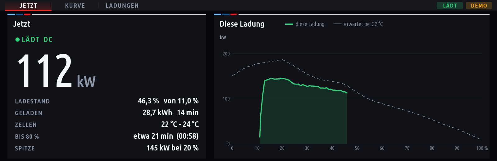
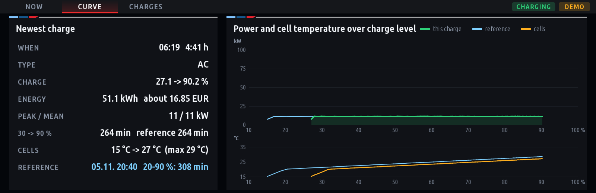
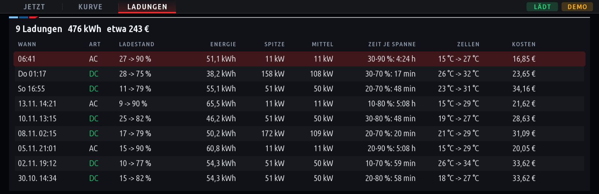
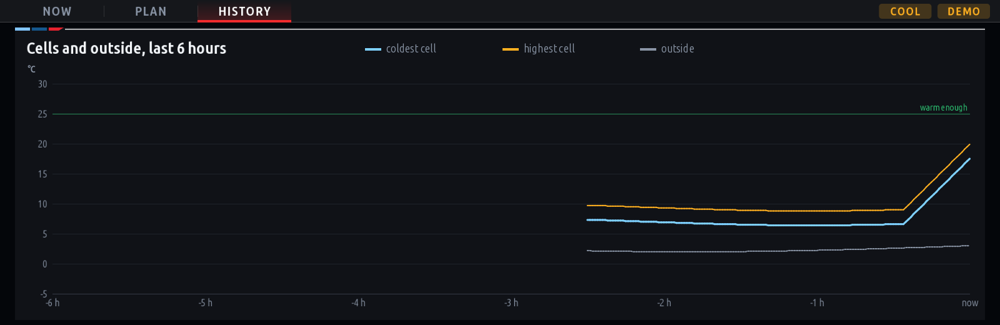
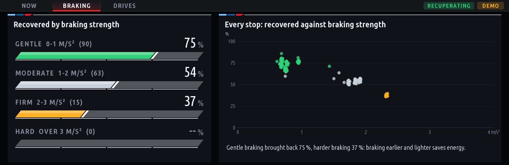
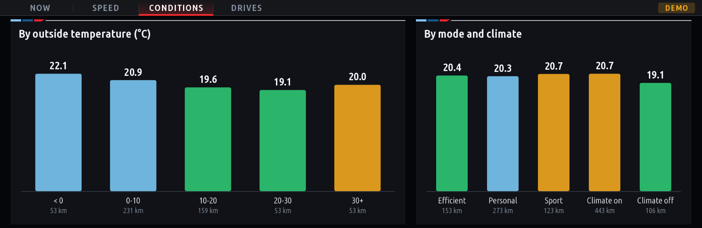

# i4 EV Apps für den MGU Store

Vier Apps für BMW-Elektroautos mit iDrive 8 (OS 8) oder iDrive 7. Gemacht für den **i4 (G26)**, gedacht auch für
andere BMW mit eDrive der 5. Generation (iX3, iX). Installiert werden sie über den
[mgu-store](https://github.com/robertnisipeanu/mgu-store).

| App | Was sie zeigt |
|---|---|
| **Ladekurve** | Zeichnet jede Ladung auf: Leistung über Ladestand, Zelltemperatur, Energie, Kosten und die Zeit pro 10 %. Vergleicht jede Ladung mit deiner besten und lernt, was dein Auto bei welcher Temperatur wirklich lädt. Auf Wunsch **live auf iPhone und Apple Watch** (siehe unten). |
| **Vorkonditionierung** | Ist der Akku warm genug zum Schnellladen? Zeigt Zelltemperatur, Aufwärmrate, die erwartete DC-Leistung und die Zeit bis 80 % (jetzt und bei warmem Akku) und was eine Ankunft in 10, 20 oder 30 Minuten bringt. |
| **Rekuperation** | Zeigt die zurückgewonnene Energie pro Fahrt und insgesamt, ihren Anteil am Verbrauch und die gewonnene Reichweite. Für jede Bremsung: wie viel der Bewegungsenergie zurück in den Akku ging, je nach Bremsstärke. |
| **Effizienz-Coach** | Zeigt den echten Verbrauch aus der Energie des Akkus, verglichen mit dem, was dein Auto bei gleichem Tempo sonst braucht. Dazu Verbrauch nach Tempo, Außentemperatur, Fahrmodus und Klima, sowie die Reichweite beim aktuellen Fahrstil. |

> **Hinweis:** Inoffizielles Hobbyprojekt, nicht von BMW. Benutzung auf eigenes Risiko; die Apps sind für den
> Blick im Stand oder vom Beifahrer gedacht. Sie **lesen nur** (UDS `0x22 ReadDataByIdentifier`) und schreiben
> nichts ins Auto.

## Stand: noch nicht im Auto getestet

- **Getestet:**
  - 22 Logiktests in `node test/run.js`, darunter der ganze UDS-Weg gegen ein simuliertes Batteriesteuergerät für die DIDs der 5. und der 4. Generation und der Live-Weg zum iPhone (Verschlüsselung, Namensauflösung über das Uplink, TLS, Relay);
  - 6 Tests des Relays in `node relay/test/run.mjs`;
  - die Vorschau aller Seiten mit Demo-Daten und ohne Daten (`tools/preview.sh`);
  - eine Prüfung auf Syntax, die die Headunit (Node 8.16) nicht kennt (`tools/check_node8.sh`).
- **Nicht getestet:** auf einer echten Headunit oder in einem i4.
  - Die DIDs des Batteriesteuergeräts (SME, `0x07`) stammen aus Mitschnitten von iX3 und iX ([OBDb](https://github.com/OBDb)), also derselben eDrive-Generation.
  - Für den G26 bestätigt sind dort nur Tempo (`D107`) und Kilometerstand (`D10D`) am Kombi.
  - Der Bau mit dem echten BMW-SDK auf der Headunit lief noch nie.

**Darum beim ersten Start im Auto:** In jeder App unter Einstellungen die **Diagnoseseite** einschalten. Sie
zeigt jede UDS-Antwort mit Rohbytes, Wert oder Fehler. Wenn ein Wert fehlt oder unplausibel ist, lassen sich DIDs
und Skalierung pro App in `apps/<id>/app.json` unter `config.hv` anpassen (Vorlage und alle Kandidaten:
`lib/ev_hv.js`, `DEFAULTS`).

## Installation über den MGU Store

Voraussetzung: Der MGU Store ist auf der Headunit installiert. Dazu braucht man Root-SSH, siehe die
[README des Stores](https://github.com/robertnisipeanu/mgu-store#requirements).

1. Im Auto: Store → Settings → **Add source** → `Freeway6/BMWeDriveApps` eingeben → den Branch `main` wählen.
   Ist das Repository privat, braucht der Store dafür einen Zugang (Settings → **Accounts**: *Sign in with GitHub*
   oder ein Token mit Leserecht auf *Contents*).
2. Im Store die Apps öffnen und **Install** tippen. Die Headunit baut sie selbst aus dem Quelltext; das BMW-SDK nimmt sie von einer Original-App im Auto.
3. Auf iDrive 8 werden Installationen erst nach einem Neustart der Headunit wirksam: Settings → **Restart head unit**.
4. Neue Commits auf `main` erscheinen im Store als Update (Installed → **Update**).

Für eine Grafik mit 60 fps sorgt der Renderer, den der Store mitinstalliert. Ohne ihn zeichnen die Apps
langsamer (PNG, etwa 2 Bilder/s).

## Wie die Apps lesen

- **Batterie** (UDS am Batteriesteuergerät `0x07`; Kandidaten in dieser Reihenfolge):
  - Ladestand `E5CE` (sonst `DDBC`);
  - Energie gespeichert/nutzbar `E5C7`;
  - Spannung `E54D` (sonst `DD68`/`DDB4`);
  - Strom `E561` (sonst `DD69`);
  - Zelltemperaturen `DDC0`;
  - Zellspannungen `E553`.
- **Kombi** (`0x60`): Kilometerstand `D10D`. **Ladeeinheit** (`0x14`): DC-Stecker `DEF7`.
- **Fahrzeugsignale** (SOME/IP, ohne Anfrage): Tempo, Außentemperatur, Fahrzeugzustand, Fahrmodus, Klima an/aus, Batterietemperatur.
- **Stromrichtung:** Die Apps lernen sie selbst. Laden im Stand mit mehr als 12 kW heißt „in den Akku“. Erzwingen lässt sie sich mit der Einstellung *Stromrichtung des Akkus*.
- **Bus-Ruhe:** Ist das Auto abgeschlossen und verlassen (Fahrzeugzustand ≤ 3), lesen die Apps nicht, damit es einschlafen kann.
  - Ausnahme 1: eine laufende Ladung.
  - Ausnahme 2: die ersten 10 Minuten nach dem Verlassen, falls erst danach eingesteckt wird.
- **Hintergrund:** Die Apps starten mit dem Auto (`autostart`) und zeichnen auf, solange die Headunit an ist. Eine Ladung, die die Headunit verschläft, wird beim nächsten Start mit dem dann gültigen Ladestand abgeschlossen und als „partly“ markiert.
- **Daten** bleiben im Datenordner der App auf der Headunit. Ins Internet geht nur, was *Ladekurve* mit eingeschaltetem „Live“ sendet: verschlüsselt an dein eigenes Relay (Abschnitt unten). *Ladekurve* legt ihr gelerntes Ladeprofil zusätzlich unter `/tmp/i4ev-charge-grid.json` ab; *Vorkonditionierung* liest es dort.

Die Ladekurve, mit der *Vorkonditionierung* und *Ladekurve* rechnen, ist eine typische veröffentlichte Kurve für den
83,9-kWh-Akku: bis 205 kW, 10→80 % in etwa 31 min bei warmem Akku. Die Temperaturabhängigkeit ist eine
Schätzung. Sobald *Ladekurve* echte Ladungen gesehen hat, ersetzen die gelernten Werte die Schätzung.

## Live auf iPhone und Apple Watch

Die *Ladekurve* kann die laufende Ladung ans iPhone und an die Apple Watch geben. Dort erscheinen eine App, eine
Live-Aktivität (Sperrbildschirm, Dynamic Island, Smart Stack der Uhr) und Komplikationen fürs Zifferblatt.

```
Headunit (Ladekurve) ──HTTPS, Ende-zu-Ende verschlüsselt──▶ dein Relay (Cloudflare, kostenlos) ◀── iPhone, Apple Watch
```

- **Was gesendet wird:**
  - beim Laden alle 15 Sekunden (Einstellung): Ladestand, Leistung, Zelltemperatur, Energie, Kosten und die
    **Prognose** für den Rest der Ladung, nach der gelernten Ladekurve;
  - wenn sie sich ändert: die Kurve mit Referenz und erwarteter Kurve;
  - ohne Ladung: alle 5 Minuten der Ladestand.
- **Verschlüsselung:**
  - AES-256-GCM mit einem Schlüssel, den die Headunit selbst erzeugt und nur als QR-Code auf ihrer Seite „iPhone“
    zeigt. Er steht nicht im Repository.
  - Das Relay sieht nur Chiffretext.
- **Internet im Auto:** nur über das Uplink des MGU Stores (LTE-Stick, Handy-Hotspot per WLAN, ein iPhone per USB
  oder das WLAN zu Hause). Die Ladekurve meldet dazu `mguInternet` an. Die Headunit löst Namen über die
  DNS-Server des Uplinks auf, weil ihr eigener Resolver das Internet nicht erreicht.
- **Grenze:** Mit abgeschlossenem Auto schläft die Headunit nach kurzer Zeit, auch beim Laden; das zeigt auch
  idrive7-apps' eDrive-App. Dann kommen keine neuen Werte. iPhone und Uhr rechnen mit der Prognose weiter und
  zeigen das als „Prognose“ an. Bist du im Auto oder ist es offen, ist es live.

Einrichten:

1. Relay einrichten: `relay/README.md` (Cloudflare-Konto, `npx wrangler deploy`, etwa 5 Minuten).
2. Dessen Adresse in `apps/i4ev_charge/app.json` unter `config.live.relay` eintragen, committen und pushen. Im
   Auto die Ladekurve im Store aktualisieren (Version 0.3.0 oder neuer).
3. Im Auto ein Uplink verbinden (Store → Settings → Wi-Fi, oder LTE-Stick bzw. Handy per USB). Der Store zeigt dann
   `Online`.
4. Ladekurve → Einstellungen → **Live auf iPhone und Apple Watch** einschalten.
5. iPhone- und Watch-App bauen und installieren: `ios/README.md` (Xcode, XcodeGen; ein kostenloser Apple-Account
   genügt).
6. Auf der Seite **iPhone** der Ladekurve den QR-Code mit der Kamera-App scannen.

Ohne Auto ausprobieren: `node tools/live_demo.js <Relay-Adresse> --fast 10` sendet eine simulierte Ladung mit
demselben Code wie die Headunit und zeigt den QR-Code im Terminal.



## Bildschirme (Vorschau mit Demo-Daten)

**Ladekurve**





**Vorkonditionierung**




**Rekuperation**





**Effizienz-Coach**





Die Oberfläche ist deutsch: Dezimalkomma, €, deutsche Wochentage. Die Fahrmodi heißen wie im Auto (Personal,
Sport, Efficient). Für die Umlaute bringen die Apps eigene Schriftatlanten mit (`i18n/fonts/de`): die des Kits,
um ÄÖÜäöüß ergänzt, mit `tools/bake_german.py` aus derselben Ubuntu-Schrift erzeugt. Alle übrigen Zeichen sind
pixelgleich, das Skript prüft das. Die Texte, die das Kit selbst zeichnet („Settings“, „Back“, „On/Off“ …),
übersetzt der Katalog `i18n/de.json`.

## Entwicklung

Voraussetzungen: Python 3, Node.js. Ein Auto ist dafür nicht nötig.

```sh
node test/run.js            # Logiktests (lib/), inkl. UDS-Weg gegen ein simuliertes Steuergerät und Live-Weg
node relay/test/run.mjs     # Tests des Relays
tools/preview.sh            # baut alle Apps ohne SDK und speichert jede Seite als PNG in preview/<id>/
node tools/live_demo.js <relay> --fast 10   # eine simulierte Ladung ans Relay, für iPhone und Watch
tools/check_node8.sh        # Syntax, die Node 8.16 auf der Headunit nicht kennt
node tools/make_icons.js    # die vier Kachel-Icons
```

| Pfad | Inhalt |
|---|---|
| `apps/<id>/` | `app.json` (Signale, Bildschirme, Einstellungen, `config.hv`), `main.js`, `icon.png` |
| `lib/` | gemeinsamer Code, beim Bau flach in jede App kopiert: Batterie lesen (`ev_hv`), Signale, Ladesitzungen, Fahrten, Bremsungen, Verbrauch, Lademodell, Demo; Live zum iPhone (`ev_live`: Uplink, DNS, HTTPS, Verschlüsselung; `ev_livedoc`: was gesendet wird; `ev_roots`: Stammzertifikate) |
| `relay/` | das Relay für Live (Cloudflare Worker), Tests und ein lokaler Testserver; siehe `relay/README.md` |
| `ios/` | die iPhone- und Watch-App „i4 Laden“ (SwiftUI, XcodeGen); siehe `ios/README.md` |
| `kit/` | MGU App Kit aus [idrive7-apps](https://github.com/cauliflowermossgrape/idrive7-apps) (MIT), unverändert übernommen; siehe `kit/README.md` |
| `i18n/` | Deutsch: Katalog für die Texte des Kits (`de.json`) und die Schriftatlanten mit Umlauten (`fonts/de/`) |
| `tools/build.py` | baut eine App als deutsches Paket: `lib/` hinein kopieren, dann der Bau des Kits mit den deutschen Atlanten und dem Katalog; `"internet": true` in `app.json` wird `mguInternet` im Paket. Der Store ruft das auf der Headunit auf (`mgu-repo.json`) |
| `tools/bake_german.py` | erzeugt `i18n/fonts/de` neu (Pillow mit raqm, Ubuntu-Schrift: `apt-get install fonts-ubuntu`) |
| `mgu-repo.json` | Beschreibung für den Store: Apps in `apps/*`, Bau auf der Headunit |

Der Code läuft auf der Headunit mit Node 8.16. Darum gibt es kein `?.`, kein `??`, kein `Array.flat` und kein
rekursives `mkdir`.

## Lizenz

MIT (`LICENSE`). Drittanbieter-Teile: `THIRD_PARTY_NOTICES.md`.
