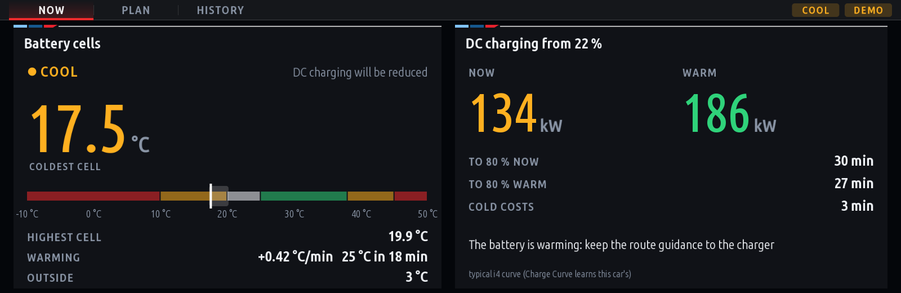
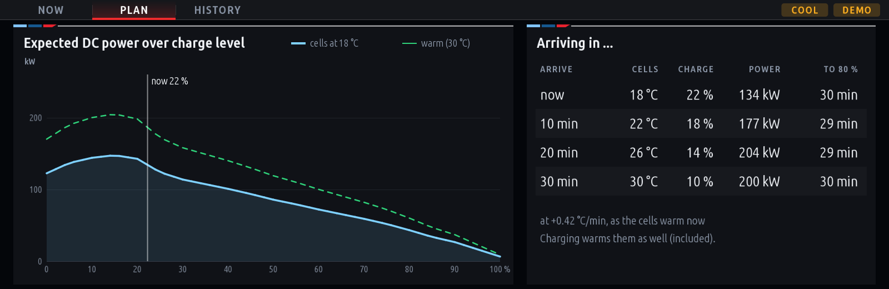
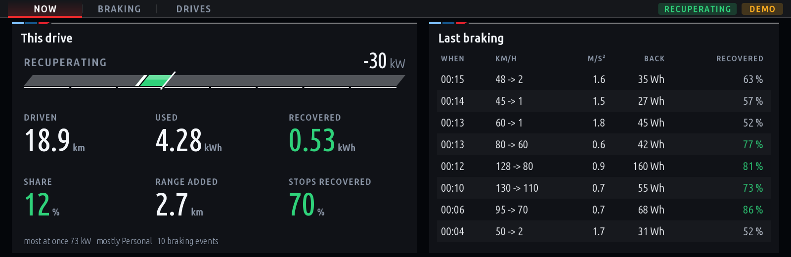
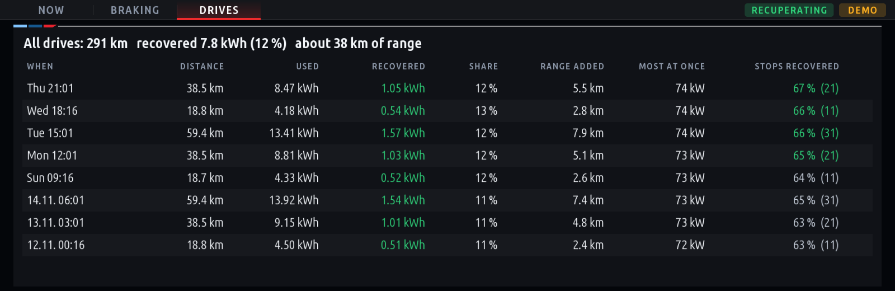
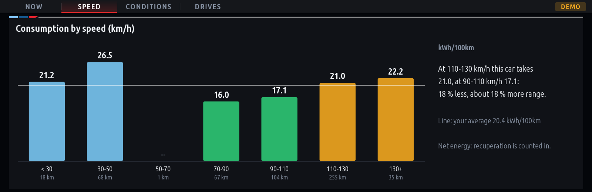

# i4 EV Apps für den MGU Store

Vier Apps für BMW-Elektroautos mit iDrive 8 (OS 8) oder iDrive 7. Gemacht für den **i4 (G26)**, gedacht auch für
andere BMW mit eDrive der 5. Generation (iX3, iX). Installiert werden sie über den
[mgu-store](https://github.com/robertnisipeanu/mgu-store).

| App | Was sie zeigt |
|---|---|
| **Charge Curve** | Zeichnet jede Ladung auf: Leistung über Ladestand, Zelltemperatur, Energie, Kosten und die Zeit pro 10 %. Vergleicht jede Ladung mit deiner besten und lernt, was dein Auto bei welcher Temperatur wirklich lädt. |
| **Precondition** | Ist der Akku warm genug zum Schnellladen? Zeigt Zelltemperatur, Aufwärmrate, die erwartete DC-Leistung und die Zeit bis 80 % (jetzt und bei warmem Akku) und was eine Ankunft in 10, 20 oder 30 Minuten bringt. |
| **Recuperation** | Zeigt die zurückgewonnene Energie pro Fahrt und insgesamt, ihren Anteil am Verbrauch und die gewonnene Reichweite. Für jede Bremsung: wie viel der Bewegungsenergie zurück in den Akku ging, je nach Bremsstärke. |
| **Efficiency Coach** | Zeigt den echten Verbrauch aus der Energie des Akkus, verglichen mit dem, was dein Auto bei gleichem Tempo sonst braucht. Dazu Verbrauch nach Tempo, Außentemperatur, Fahrmodus und Klima, sowie die Reichweite beim aktuellen Fahrstil. |

> **Hinweis:** Inoffizielles Hobbyprojekt, nicht von BMW. Benutzung auf eigenes Risiko; die Apps sind für den
> Blick im Stand oder vom Beifahrer gedacht. Sie **lesen nur** (UDS `0x22 ReadDataByIdentifier`) und schreiben
> nichts ins Auto.

## Stand: noch nicht im Auto getestet

- **Getestet:**
  - 13 Logiktests in `node test/run.js`, darunter der ganze UDS-Weg gegen ein simuliertes Batteriesteuergerät für die DIDs der 5. und der 4. Generation;
  - die Vorschau aller Seiten mit Demo-Daten und ohne Daten (`tools/preview.sh`);
  - eine Prüfung auf Syntax, die die Headunit (Node 8.16) nicht kennt (`tools/check_node8.sh`).
- **Nicht getestet:** auf einer echten Headunit oder in einem i4.
  - Die DIDs des Batteriesteuergeräts (SME, `0x07`) stammen aus Mitschnitten von iX3 und iX ([OBDb](https://github.com/OBDb)), also derselben eDrive-Generation.
  - Für den G26 bestätigt sind dort nur Tempo (`D107`) und Kilometerstand (`D10D`) am Kombi.
  - Der Bau mit dem echten BMW-SDK auf der Headunit lief noch nie.

**Darum beim ersten Start im Auto:** In jeder App unter Einstellungen die **Diagnostics page** einschalten. Sie
zeigt jede UDS-Antwort mit Rohbytes, Wert oder Fehler. Wenn ein Wert fehlt oder unplausibel ist, lassen sich DIDs
und Skalierung pro App in `apps/<id>/app.json` unter `config.hv` anpassen (Vorlage und alle Kandidaten:
`lib/ev_hv.js`, `DEFAULTS`).

## Installation über den MGU Store

Voraussetzung: Der MGU Store ist auf der Headunit installiert. Dazu braucht man Root-SSH, siehe die
[README des Stores](https://github.com/robertnisipeanu/mgu-store#requirements).

1. Dieses Repository auf GitHub veröffentlichen (öffentlich, oder privat mit Token im Store).
2. Im Auto: Store → Settings → **Add source** → `<owner>/<repo>` eingeben → den Branch `main` wählen.
3. Im Store die Apps öffnen und **Install** tippen. Die Headunit baut sie selbst aus dem Quelltext; das BMW-SDK nimmt sie von einer Original-App im Auto.
4. Auf iDrive 8 werden Installationen erst nach einem Neustart der Headunit wirksam: Settings → **Restart head unit**.

Für eine Grafik mit 60 fps sorgt der Renderer, den der Store mitinstalliert. Ohne ihn zeichnen die Apps
langsamer (PNG, etwa 2 Bilder/s).

## Wie die Apps lesen

- **Batterie** (UDS am Batteriesteuergerät `0x07`; Kandidaten in dieser Reihenfolge):
  - Ladestand `E5CE` (sonst `DDBC`);
  - Energie gespeichert/nutzbar `E5C7`;
  - Spannung `E54D` (sonst `DD68`/`DDB4`);
  - Strom `E561` (sonst `DD69`);
  - Zelltemperaturen `DDC0`;
  - Zellspannungen `E553`.
- **Kombi** (`0x60`): Kilometerstand `D10D`. **Ladeeinheit** (`0x14`): DC-Stecker `DEF7`.
- **Fahrzeugsignale** (SOME/IP, ohne Anfrage): Tempo, Außentemperatur, Fahrzeugzustand, Fahrmodus, Klima an/aus, Batterietemperatur.
- **Stromrichtung:** Die Apps lernen sie selbst. Laden im Stand mit mehr als 12 kW heißt „in den Akku“. Erzwingen lässt sie sich mit der Einstellung *Battery current direction*.
- **Bus-Ruhe:** Ist das Auto abgeschlossen und verlassen (Fahrzeugzustand ≤ 3), lesen die Apps nicht, damit es einschlafen kann.
  - Ausnahme 1: eine laufende Ladung.
  - Ausnahme 2: die ersten 10 Minuten nach dem Verlassen, falls erst danach eingesteckt wird.
- **Hintergrund:** Die Apps starten mit dem Auto (`autostart`) und zeichnen auf, solange die Headunit an ist. Eine Ladung, die die Headunit verschläft, wird beim nächsten Start mit dem dann gültigen Ladestand abgeschlossen und als „partly“ markiert.
- **Daten** bleiben im Datenordner der App auf der Headunit; nichts geht ins Internet. *Charge Curve* legt ihr gelerntes Ladeprofil zusätzlich unter `/tmp/i4ev-charge-grid.json` ab; *Precondition* liest es dort.

Die Ladekurve, mit der *Precondition* und *Charge Curve* rechnen, ist eine typische veröffentlichte Kurve für den
83,9-kWh-Akku: bis 205 kW, 10→80 % in etwa 31 min bei warmem Akku. Die Temperaturabhängigkeit ist eine
Schätzung. Sobald *Charge Curve* echte Ladungen gesehen hat, ersetzen die gelernten Werte die Schätzung.

## Bildschirme (Vorschau mit Demo-Daten)

**Charge Curve**


**Precondition**





**Recuperation**





**Efficiency Coach**





Die Oberfläche ist englisch. Die Schriftatlanten des Kits haben keine Umlaute; eine deutsche Fassung bräuchte
neu gebackene Atlanten (`bake_fonts.py` im Kit).

## Entwicklung

Voraussetzungen: Python 3, Node.js. Ein Auto ist dafür nicht nötig.

```sh
node test/run.js            # Logiktests (lib/), inkl. UDS-Weg gegen ein simuliertes Steuergerät
tools/preview.sh            # baut alle Apps ohne SDK und speichert jede Seite als PNG in preview/<id>/
tools/check_node8.sh        # Syntax, die Node 8.16 auf der Headunit nicht kennt
node tools/make_icons.js    # die vier Kachel-Icons
```

| Pfad | Inhalt |
|---|---|
| `apps/<id>/` | `app.json` (Signale, Bildschirme, Einstellungen, `config.hv`), `main.js`, `icon.png` |
| `lib/` | gemeinsamer Code, beim Bau flach in jede App kopiert: Batterie lesen (`ev_hv`), Signale, Ladesitzungen, Fahrten, Bremsungen, Verbrauch, Lademodell, Demo |
| `kit/` | MGU App Kit aus [idrive7-apps](https://github.com/cauliflowermossgrape/idrive7-apps) (MIT), unverändert übernommen; siehe `kit/README.md` |
| `tools/build.py` | baut eine App: `lib/` hinein kopieren, dann der Bau des Kits; der Store ruft das auf der Headunit auf (`mgu-repo.json`) |
| `mgu-repo.json` | Beschreibung für den Store: Apps in `apps/*`, Bau auf der Headunit |

Der Code läuft auf der Headunit mit Node 8.16. Darum gibt es kein `?.`, kein `??`, kein `Array.flat` und kein
rekursives `mkdir`.

## Lizenz

MIT (`LICENSE`). Drittanbieter-Teile: `THIRD_PARTY_NOTICES.md`.
